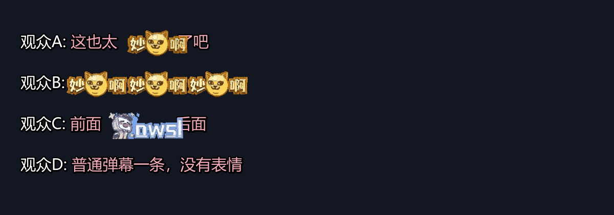

# emote-danmaku

把**录播姬**录下的直播弹幕里那些 `[妙啊]`、`[awsl]`、`[热]` 之类的**表情包**，
在压制后的视频里真正显示成图片，而不是一行 `[表情名]` 文字。

```
录播姬 ── danmaku.xml ──> DanmakuFactory ── danmaku.ass ──> emote-danmaku convert ──> danmaku.emote.ass ──> ffmpeg ──> mp4
                                                                   ▲
                                                         本地表情包库 emotes/
```

---

## 目录

- [1. 为什么需要这个工具](#1-为什么需要这个工具)
- [2. 效果对比](#2-效果对比)
- [3. 安装](#3-安装)
- [4. 三步上手](#4-三步上手)
- [5. 一键脚本](#5-一键脚本-auto_pipelinepy)
- [6. 批处理菜单](#6-批处理菜单-windows)
- [7. 参数速查](#7-参数速查)
- [8. 工作原理](#8-工作原理)
- [9. 已知限制](#9-已知限制)
- [10. 常见问题](#10-常见问题)
- [11. 开发与测试](#11-开发与测试)
- [12. 致谢与许可](#12-致谢与许可)

---

## 1. 为什么需要这个工具

| 环节 | 现状 |
| --- | --- |
| 录播姬 | 把表情弹幕原样写成文本，例如 `<d ...>[妙啊]</d>`。表情图片地址只存在「录制弹幕原始数据」开启时的 `raw` 属性里。 |
| DanmakuFactory | 只把文本转成 ASS，本身不支持图片，所以 ASS 里就是 `[妙啊]` 这几个字。 |
| ffmpeg / libass | **不支持** ASS 的 `\1img` 图片标签（实测渲染不出任何像素），因此「把 PNG 塞进 ASS」这条路走不通。 |

`emote-danmaku` 的做法：**把表情图转成 ASS 矢量绘图（`\p1`）内联进字幕**。

这样只需要一次 `ffmpeg -vf ass=...` 就能连文字带表情一起压进视频，不额外增加转码次数，
字幕文件仍然是单个自包含的 `.ass`（剪裁、转封装都不会丢表情）。

---

## 2. 效果对比



上图四行分别是：**文字中间夹表情**、**多个表情连发**、**文字夹表情**、**普通文字弹幕**。
表情是从原图矢量化来的，与文字自然衔接、不重叠。

跑一遍自带的示例就能自己复现：

```bash
python examples/make_demo.py       # 生成完整 demo.mp4 与前后对比图
python examples/make_showcase.py   # 重新生成 docs/preview.png
```

---

## 3. 安装

只需要 Python 3.9+ 和 Pillow。

```bash
pip install pillow
```

在本目录下即可直接运行，无需安装：

```bash
python -m emote_danmaku --help
```

还需要 **DanmakuFactory CLI**（把 XML 转成 ASS）。从
<https://github.com/hihkm/DanmakuFactory/releases/tag/dev> 下载
`DanmakuFactory-dev-windows-x64-CLI.zip`，解压后把 `DanmakuFactory.exe` 放到
`tools/DanmakuFactory/`。

> 本仓库**不附带** `DanmakuFactory.exe`，请自行下载，遵守其 GPL-3.0 许可。

---

## 4. 三步上手

### 第一步：准备本地表情包库

三种来源，任选其一或混用。

**A. 从录播姬的弹幕 XML 里自动抓（最省事，推荐）**

录播姬设置里打开 **录制弹幕 → 录制弹幕原始数据**，然后：

```bash
python -m emote_danmaku library harvest "D:/录播/xxx.xml"
```

它会读出每条弹幕 `raw` 里的 `info[0][15].extra.emots`，
只下载这场直播里**实际用过**的表情图片。

**B. 直接拉整个直播间的表情包**

```bash
python -m emote_danmaku library fetch --room 12345 --cookie "SESSDATA=xxxx"
```

`--cookie` 可选；不带时 B 站通常只返回通用表情包。也可以把 cookie 放进环境变量
`BILIBILI_COOKIE`，避免写进命令行历史。

**C. 手动放图片**

```bash
python -m emote_danmaku library add "D:/我的表情/妙啊.png"
python -m emote_danmaku library add "D:/我的表情/整个文件夹" --trace
```

文件名就是表情名（`妙啊.png` → `[妙啊]`），`--trace` 会立刻试着矢量化并报出用了几个色块。
文件名带不带方括号都行，`[妙啊].png` 与 `妙啊.png` 等价。

查看库里有什么：

```bash
python -m emote_danmaku library list
```

表情库就是普通文件夹，可以随便改：

```
emotes/
  index.json          # 名称 / 唯一 ID / 来源 / 文件 的索引
  images/<sha1>.png   # 原图
  vector/<hash>.json  # 矢量缓存（可删，会自动重建）
```

### 第二步：把 ASS 里的 `[表情]` 换成图

```bash
DanmakuFactory.exe -o ass danmaku.ass -i xml danmaku.xml -r 1920x1080 --font-size-strict
python -m emote_danmaku convert danmaku.ass -o danmaku.emote.ass
```

输出会告诉你命中多少、还缺哪些：

```
已写入 danmaku.emote.ass
  处理弹幕 3 条，绘制表情 5 个
  命中：[妙啊]×5
  未收录 2 处：[热]×1，[微笑]×1
```

缺的表情照旧显示为文字，不会报错。补齐后重新 `convert` 即可。

> **务必加 `--font-size-strict`**。DanmakuFactory 默认会按每条弹幕自带的字号重新缩放，
> 于是 ASS 里写着 `fontsize=40`，libass 实际只画约 29px 的字。这样「按 40 算出来的文字宽度」
> 比真实渲染宽了约三分之一，表情定位就会偏。详见[工作原理](#8-工作原理)。

### 第三步：压制

```bash
python -m emote_danmaku burn "D:/录播/xxx.flv" danmaku.emote.ass -o out.mp4
# 等价于你自己敲：
# ffmpeg -i xxx.flv -vf "ass='danmaku.emote.ass'" -c:v libx264 -preset medium -crf 20 -c:a copy out.mp4
```

想先看效果，不用压整段：

```bash
python -m emote_danmaku preview danmaku.emote.ass -o frame.png --at 12.5
```

---

## 5. 一键脚本 `auto_pipeline.py`

上面三步可以用一条命令跑完，**标准模式录制（不开「保留原始弹幕数据」）也能用**：

```bash
# 1. 先体检：这场直播用了哪些表情、本地库覆盖多少
python auto_pipeline.py report "D:/录播/xxx.xml"

# 2. 建库（任选）
python auto_pipeline.py import "D:/我的表情"                            # 文件名=表情名
python auto_pipeline.py fetch --room 12345 --cookie "SESSDATA=..."     # 整个直播间表情包
python auto_pipeline.py harvest "D:/录播/xxx.xml"                       # 需开了 raw 数据

# 3. 一键出片：自动找同名 .flv，自动转 ASS、注入表情、导预览图、压制
python auto_pipeline.py run "D:/录播/xxx.xml" -o "D:/out/xxx.mp4"
```

`report` 的示例输出：

```
弹幕条数   847
时间跨度   198.8 分钟（7.0s ~ 11937.1s）
表情 token 47 种，共出现 304 次
本地可覆盖 145/304 处（48%），4/47 种

出现最多的表情：
  OK [dog]                        x93
  -- [示例主播_偷笑]              x30
缺失 47 种。补齐方式：...
注：本文件没有 raw 原始数据，harvest 不可用（标准模式录制的正常现象）
```

`run` 会自动：

1. 用 `ffprobe` 读视频分辨率，按同分辨率让 DanmakuFactory 转 ASS；
2. 注入表情，打印命中/缺失；
3. 导出预览图（`--preview 秒数`）；
4. 调 ffmpeg 压制（`--crf / --preset / --extra` 可调）。

同目录没有同名视频时，它只生成 ASS 和预览图，并打印可直接用的 ffmpeg 命令。

### 关于「不开原始弹幕数据」

标准模式录制的 XML **没有 `raw` 属性**，拿不到表情图片地址，`harvest` 会明确报错并给替代方案：

| 方式 | 需要登录 | 说明 |
| --- | --- | --- |
| `import <文件夹>` | 否 | 最稳。文件名即表情名（`dog.png` → `[dog]`） |
| `fetch --room` | 是（SESSDATA） | 一次拉全直播间表情包，含房主专属表情 |
| `harvest` | 否 | 仅当录播姬开了「录制弹幕原始数据」 |

匿名调 B 站表情接口会返回 `code=-101 账号未登录`，所以 `fetch` 必须自带 cookie；
这也是本项目强调**本地表情包库**的原因。

---

## 6. 批处理菜单（Windows）

双击 `一键出片.bat`，或把 `.xml` / `.flv` 拖到它上面。

```
[1] 更新本直播间表情包     [2] 只生成 ASS 不压制
[3] 打开表情库文件夹       [4] 编辑 config.json
[5] 重新扫描表情库         [6] 切换编码器（GPU / CPU）
[0] 退出
```

配置全部在 `config.json` 里，带 `_` 前缀的键是注释。详见 [批处理使用说明.md](批处理使用说明.md)。

---

## 7. 参数速查

```
python -m emote_danmaku [--library DIR] <命令>

library add     <图片或文件夹...> [--name 名字] [--trace] [--overwrite]
library fetch   --room 房间号 [--cookie ...] [--platform pc|android|ios]
library harvest <弹幕.xml> [--all] [--cookie ...]
library list    [--json]
library prune   [--vectors] [--all]

convert <danmaku.ass> [-o 输出.ass]
        [--emote-scale 1.30]     表情高度 / 字号
        [--gap-tweak 0.0]        表情与左侧文字的贴合微调
        [--max-colors 10]        矢量化色数上限（越小 ASS 越小）
        [--tolerance 0.5]        轮廓简化容差
        [--unknown text|drop]    没收录的表情：保留文字 / 丢掉
        [--font-dir DIR]         字体目录（默认 C:\Windows\Fonts）

preview <danmaku.ass> [-o 图片] [--at 秒]
burn    <视频> <danmaku.ass> [-o 输出] [--crf 20] [--preset medium] [--extra "..."]
```

调参提示：

- 表情偏大 / 偏小 → 调 `--emote-scale`（默认 1.30，即字号 40 时表情高约 52px）。
  它同时跟随 `config.json` 的 `fontsize`，改字号表情会等比变化。
- 表情与文字间隙偏大 → 调 `--gap-tweak`（0.0 起步，可试 0.05~0.1）。
- ASS 太大 → 降 `--max-colors`（8 就够用），或升 `--tolerance`。

---

## 8. 工作原理

整个项目的核心难点是「**不破坏 DanmakuFactory 已排好的版**」，以下全部经过逐像素实测确认。

### 8.1 用透明占位保住笔位

DanmakuFactory 已经按 `[妙啊]` 这段**文字**的宽度算好了滚动起点、速度和行位置。
如果直接把文字换成图片，行会变短，弹幕就会「半空出现」。

所以工具把原文字替换成一段**零高度、不可见、但会推进笔位**的绘图：

```
{\p1\bord0\shad0\1a&HFF&}m 0 0 l <墨迹宽> 0{\p0\1a&H00&}
```

实测：它**精确**推进 `<宽度>` 像素（误差 0），不改变行高，也不影响后续文字颜色。
因为位置由 libass 自己算，表情前后的文字不会随弹幕滚动而漂移。

### 8.2 表情单独成事件

真正显示的图片放在更高层的独立 `Dialogue` 里，用 `{\an7\pos(x,y)}` 或 `{\an7\move(...)}`
绝对定位到那块占位区域，起止时间、滚动轨迹与原弹幕完全一致。

### 8.3 一个颜色一个事件

libass 里只要出现第二个 `{...\p1}` 块，笔位就会前进到上一块的右侧
（实测：2 块 → 右移 40px，8 块 → 右移 300+px）。
因此多色表情必须拆成「每个色层一个事件」，各自从原点开始画。

### 8.4 字号必须严格一致

DanmakuFactory 默认按弹幕自带字号（录播姬写的是 25）缩放，导致 ASS 声明 40、
libass 实际渲染约 29px。此时「按 40 算的文字宽度」比真实渲染宽约 1/3，表情必然偏移。
加 `--font-size-strict` 后两者一致。

### 8.5 表情贴合文字

libass 画出的字形比 Pillow 的 advance 窄（实测墨迹止于 advance 的 75.5%），
所以文字后面直接放表情会留一条缝。工具按前置文字宽度乘一个系数回拉
（`_INK_RATIO`，默认 0.12），并删除录播姬 / DanmakuFactory 在表情前插入的 `\h` 硬空格
——那个空格会变成一个说不清的洞。

### 8.6 其他实测结论

- **路径不能换行**：ASS 事件里的裸换行会被当成硬换行，导致图形错位。
- **颜色字节序**：ASS 的 `\1c` 是 `&HBBGGRR&`（先蓝后绿再红），
  把 RGB 直接塞进去会让表情「红蓝互换」——金黄色的小黄脸会变成蓝色。
- **`\1img` 不可用**：libass 对 ASS 图片标签无实现，必须走矢量绘图。

---

## 9. 已知限制

- **只处理带 `\pos` / `\move` 的弹幕**。DanmakuFactory 输出的普通 / 顶部 / 底部弹幕都满足；
  没有定位标签的会原样保留文字，不会出错。
- **SuperChat / 礼物框里的表情**暂不替换（那里的文本用 `\clip` + 多段动画，几何更复杂）。
- 表情被缩放后是**矢量近似**：色数受 `--max-colors` 限制，细小渐变会有色阶。
  卡通风格的表情包基本看不出差别；照片类建议调大 `--max-colors`。
- 动态表情（GIF / WebP）只取第一帧。
- 需要 `raw` 原始数据才能 `harvest`；没开的话用 `library fetch` 或手动 `add`。
- 只在 Windows 上完整验证过（依赖 `C:\Windows\Fonts` 与 `.bat` 脚本），
  Linux / macOS 理论可用但未测试。

---

## 10. 常见问题

**Q：表情显示成蓝色 / 颜色不对？**
A：`\1c` 的字节序是 BGR 而非 RGB。本项目已处理；若你自行改代码，注意这一点。

**Q：表情和文字重叠，或间隙很大？**
A：先确认 DanmakuFactory 加了 `--font-size-strict`；再调 `--gap-tweak`。

**Q：`ERROR [code wa100] Failed to create file`？**
A：DanmakuFactory 1.70 的 CLI 用 ANSI 代码页解析参数，中文路径会变乱码。
本项目已用「复制到 ASCII 临时名再转回」规避；手工调用时把文件放英文目录即可。

**Q：`fetch` 报 `code=-101`？**
A：接口需要登录，请提供含 `SESSDATA` 的 cookie，或改用 `library add` 手动导入。

**Q：批处理里的中文乱码？**
A：`.bat` 必须以 GBK 保存并配合 `chcp 936`，UTF-8 会让 cmd 显示乱码。

**Q：其他主播的粉丝牌表情拉不到？**
A：房间接口不返回别家粉丝牌，只能手动找图丢进 `emotes/`，命名成 `示例主播_偷笑.png`。

---

## 11. 开发与测试

```bash
python -m unittest discover -s tests -v     # 24 个用例，不需要 pytest / 网络 / ffmpeg
python examples/make_demo.py                # 生成 examples/out/demo.mp4 与两张对比预览图
```

代码结构：

| 文件 | 作用 |
| --- | --- |
| `emote_danmaku/vectorize.py` | 位图 → ASS 矢量绘图（调色板量化 + 像素边界追踪 + 轮廓简化） |
| `emote_danmaku/ass.py` | 解析 / 重写 ASS，算排版，生成表情事件 |
| `emote_danmaku/library.py` | 表情库：下载、导入、索引、矢量缓存 |
| `emote_danmaku/xmlfile.py` | 读录播姬 XML，从 `raw` 里提取表情地址 |
| `emote_danmaku/cli.py` | 命令行 |
| `emote_danmaku/progress.py` | 压制进度显示 |
| `run_from_config.py` | 读 `config.json`，串起「转 ASS → 注入表情 → 压制」 |
| `auto_pipeline.py` | 独立 CLI：`report / fetch / import / harvest / run` |

欢迎提 Issue 和 PR。提交前请确保：

```bash
python -m unittest discover -s tests        # 全绿
python -m py_compile run_from_config.py auto_pipeline.py emote_danmaku/*.py
```

---

## 12. 致谢与许可

- [BililiveRecorder](https://github.com/Bililive/BililiveRecorder) — 直播录制与弹幕
- [DanmakuFactory](https://github.com/hihkm/DanmakuFactory) — 弹幕 XML → ASS 排版
- [bilibili-API-collect](https://github.com/SocialSisterYi/bilibili-API-collect) — 表情接口文档

本项目代码以 **MIT** 许可发布，见 [LICENSE](LICENSE)。

**本项目不包含任何 B 站素材**：不含录播视频、不含表情图片、不含登录凭据。
表情图片由使用者自行获取并放在本地 `emotes/` 目录，该目录已在 `.gitignore` 中排除。
使用时请遵守 B 站用户协议，仅处理你自己有权使用的内容。
